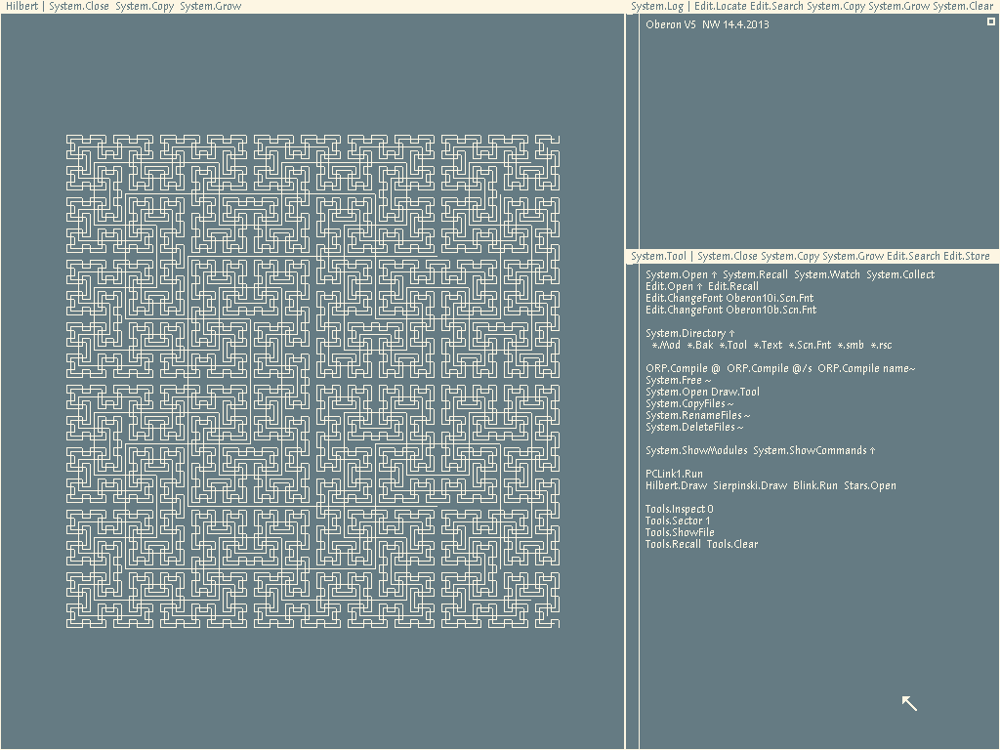

# oberon-risc-emu-ocaml

[](https://github.com/zxygentoo/oberon-risc-emu-ocaml/actions/workflows/ci.yml)

An emulator for the RISC5 machine that runs Niklaus Wirth's [Project Oberon][po]
(2013), in OCaml:

- **a core library** (`oberon-risc`) — the whole machine: CPU, software floating
  point, MMIO, SD-card disk, serial, clipboard, and the instruction codec. It is
  **bit-exact** to [Peter De Wachter's C emulator][c], verified against it down to
  individual instructions (see [Verifying correctness](#verifying-correctness)), and
  needs nothing beyond the OCaml distribution;
- **`risc`** (`oberon-risc-emu`) — the emulator in a window, via [`tsdl`][tsdl] (SDL2),
  or headless;
- **host tools** (`oberon-risc-tools`) — text converters, a source extractor, and
  image builders that compile a Project Oberon or Extended Oberon source tree into
  a bootable disk image; plus `oat`, an experimental client that drives a running
  Oberon over a serial line.

It began as a port of the C emulator by way of the Rust port
[`oberon-risc-emu-rs`][rs]; the core is now what [oberon-risc-hardcaml][hc] (an FPGA
implementation of the machine, tested in lockstep against it) and
[DOOM-on-Oberon][doom] build on.



*The bundled image, booted through the library and middle-clicked on
`Hilbert.Draw` — pixel for pixel the screen in the C emulator's README.*

## Packages

Three opam packages, released together at one version (see [`CHANGES.md`](CHANGES.md)
and [Stability](#stability)):

| Package | What | Needs |
| --- | --- | --- |
| `oberon-risc` | The machine as a library — module `Oberon_risc` | the OCaml distribution only |
| `oberon-risc-emu` | The `risc` command (window, input, screenshots, headless runs) | SDL2, via `tsdl` and `imagelib` |
| `oberon-risc-tools` | `ob2txt`, `txt2ob`, `extract-source`, `build-po-image`, `build-eo-image`; and `oat` (experimental) | `crunch` at build time |

## Requirements

OCaml ≥ 5.1, dune ≥ 3, and a C compiler; for `oberon-risc-emu`, the SDL2 system
library, from your OS package manager (e.g. `apt install libsdl2-dev`,
`brew install sdl2`). The OCaml dependencies come from opam:

```sh
opam install . --deps-only --with-test                    # all three packages
opam install ./oberon-risc.opam --deps-only --with-test   # just the core: no SDL
```

`tsdl` binds SDL2, `imagelib` encodes screenshots as PNG, `crunch` embeds the
host tools' toolchain assets at build time, and `qcheck-core` drives the property
tests. The C compiler builds `oat`'s serial-line stub and the vendored C
reference for the `@cosim` tests.

To install the commands: `opam install .` (or one package, e.g.
`opam install ./oberon-risc-tools.opam`). From a checkout without installing,
`dune build`, then put `dune exec --` in front of any command below
(`dune exec -- risc my.dsk`).

## Running Oberon

```sh
# windowed — the disk image is modified in place, as on real hardware, so boot
# a copy if you want to keep the original (the bundled one is a test fixture):
cp DiskImage/Oberon-2020-08-18.dsk my.dsk
risc my.dsk

# scale up, or go fullscreen:
risc --zoom 2 my.dsk
risc --fullscreen my.dsk
```

### Options

Ported from the C frontend; `--headless` and `--frames` come from the Rust port,
`--shot-frames` is new here.

| Option | Meaning |
| --- | --- |
| `--zoom REAL` | Scale the display in windowed mode |
| `--fullscreen` | Start in full-screen mode |
| `--leds` | Log the LED state to stdout |
| `--mem MEGS` | Set RAM size (1..32 MB; see below) |
| `--size WIDTHxHEIGHT` | Set framebuffer size (see below) |
| `--boot-from-serial` | Boot from the serial line (no disk image required) |
| `--serial-in FILE` / `--serial-out FILE` | Use a raw host serial line instead of PCLink |
| `--headless` | Run without a window (until killed, or `--frames` frames) |
| `--frames N` | Run N deterministic frames, print FNV-1a hashes, then exit (headless only; the image is booted in memory and left unchanged) |
| `--shot-frames N,N,..` | Save the framebuffer as `risc-shotNNNN.png` after each listed frame (with `--frames`) |
| `-h`, `--help` / `--version` | Print the usage / the version |

Without `--mem`/`--size` the machine is the reference FPGA system with 16 MiB of
RAM: 1024×768, the framebuffer just below 1 MB, and RAM above 1 MB for software
that knows (the boot ROM advertises 1 MB, so stock images never see it). Either
option switches to the C emulator's configurable layout instead — `MEGS` of RAM
(default 1) with the framebuffer right above it — so `--size` alone gives a 1 MB
machine, as in the C.

### Controls

Three-button mouse (Oberon needs all three). On a trackpad, **Left Alt** acts as
the middle button. Keyboard shortcuts, each acting once per press however long the
key is held:

| Key | Action |
| --- | --- |
| `Alt`+`F4` | Quit |
| `F12`, or `Ctrl`+`Shift`+`Del` | Reset the machine |
| `F11`, `Alt`+`Enter`, or `Cmd`+`Shift`+`F` | Toggle full-screen |
| `F10` | Save a screenshot (`risc-shotNNNN.png` in the working directory) |

## Host tools

The disk-image toolchain from the Rust workspace's `host-tools`:

```sh
# unpack a build-ready source tree from an image (writes .packonly too):
extract-source DiskImage/Oberon-2020-08-18.dsk src/

# compile the whole tree back into a bootable image:
build-po-image src/ Oberon.dsk

# convert one file between Oberon (Latin-1/CR) and host (UTF-8/LF) text:
ob2txt src/Kernel.Mod        # -> src/Kernel.Mod.txt
txt2ob src/Kernel.Mod.txt    # -> src/Kernel.Mod
```

`build-po-image` (and `build-eo-image`, its Extended Oberon counterpart) drive
the Oberon compiler headless through a port of project-norebo's shim runtime,
with the bootstrap toolchain embedded in the binary. Both directions are
verified byte-identical against the Rust tools: extracted trees compare equal,
and built images hash identically.

Every command — `risc` and the five tools — takes `-h`/`--help` and `--version`,
and exits 0 on success, 1 when the work itself fails (an unreadable file, a
broken image, a failed build), and 2 for a usage error (an unknown option,
missing or extra arguments).

## Driving a live system (oat)

> **Experimental.** `oat`'s commands, output and wire protocol may change in any
> release; they are outside the [stability promise](#stability).

`oat` — ported from [oberon-agent][oa] — drives a *running* Oberon over the
serial line: read/write/edit files, compile, load/unload modules, run any
command. It is a stateless CLI: each invocation opens the line (an emulator
FIFO pair, or a real FPGA's UART via `--serial`), performs one request against
`AgentTool.Mod` on the device, prints the result, and exits. Everything lives
under [`oat/`](oat/): the client, the on-system modules (`oat/Mod/`), and the
agent-facing rules for driving it from a coding agent
([`oat/skill/`](oat/skill/oberon-agent/SKILL.md)).

The stock images don't carry the agent modules; the root `Makefile` builds
agent-ready images with this repo's own toolchain (build-time system deps:
`make`, `patch`, and `curl`/`wget` for the EO download):

```sh
make po-image                        # DiskImage/ProjectOberon.dsk, fully offline
make eo-image                        # DiskImage/ExtendedOberon.dsk (pinned download)

mkfifo /tmp/p.in /tmp/p.out          # once
make po-emu                          # boot the image on the FIFO pair, windowed
```

then, from another shell:

```sh
OAT="oat --serial-in /tmp/p.in --serial-out /tmp/p.out"
$OAT check                           # ok: Project Oberon 2013 (round-trip 1ms)
$OAT write Stars.Mod < Stars.Mod     # push source
$OAT compile Stars.Mod               # ORP.Compile; compiler log -> stdout
$OAT call Stars.Show                 # run it; the Oberon.Log delta -> stdout
```

Swap `make po-emu` for `risc --headless --serial-in ... --serial-out ...` and
the same loop runs without a window; re-run deterministically with
`--shot-frames` to see the screen. `make test-po` / `make test-eo` run a live
battery of the full oat surface against a booted image (see
[`test/README.md`](test/README.md)).

The images rebuild when their sources, the patches or the toolchain change, and
a step that fails (a patch that no longer applies) fails the build. `make clean`
removes exactly what the pipeline wrote — other files in `build/` are left
alone — and `make distclean` also drops the EO download. Set `DUNE=` to run
the build through another dune (e.g. `DUNE='opam exec -- dune'`).

On real hardware, point `--serial` at the board's UART instead:

```sh
oat --serial /dev/ttyUSB1 check      # ok: Project Oberon 2013 (round-trip 30ms)
```

`oat` sets the line itself — raw 8N1 at `--baud` (default 115200), through its
own small C stub rather than OCaml's `Unix.tcsetattr`, whose baud table can go
stale across a glibc upgrade — and reads the settings back before sending
anything, so a line that did not take them fails at open instead of as a
timeout. If the board does not answer, `check` gives up within seconds and the
error names the port, the line settings the host verified, and what is left to
check on the device side; the skill file has the
[debugging table](oat/skill/oberon-agent/SKILL.md).

## Using the core from another project

The core is the library `oberon-risc`: `Oberon_risc.Risc` is the machine (with
`Risc.Cpu` for single-stepping and state), `Oberon_risc.Headless` the deterministic
driver, `Oberon_risc.Disk` the SD card, `Oberon_risc.Risc5_isa` the instruction
codec. Booting the bundled image for 60 frames and hashing the screen:

```ocaml
let () =
  let open Oberon_risc in
  let image =
    In_channel.with_open_bin "DiskImage/Oberon-2020-08-18.dsk" In_channel.input_all
  in
  let risc = Headless.standard_machine ~disk:(Disk.of_string image) Clipboard.noop_host in
  Headless.run_frames risc 60;
  Printf.printf "%016Lx\n" (Headless.framebuffer_hash risc)
(* b9bdbf56ba51298d *)
```

Two ways in:

- **opam**: `opam pin add oberon-risc https://github.com/zxygentoo/oberon-risc-emu-ocaml.git#v1.0.0`,
  then `(libraries oberon-risc)`.
- **A git submodule, vendored by dune**: in the directory holding the submodule,
  `(vendored_dirs oberon-risc-emu-ocaml)`, then `(libraries oberon-risc)`. Only the
  parts you use get built, so the SDL frontend never is. To keep an existing module
  name — say `Emu` — wrap it:

  ```
  ; emu/dune
  (library
   (name emu)
   (libraries oberon-risc))
  ```

  ```ocaml
  (* emu/emu.ml *)
  include Oberon_risc
  ```

  (Verified with oberon-risc-hardcaml, which today copies `lib/` instead.)

Copying `lib/*.ml{,i}` into your own library also works, and keeps working through
1.x (see [Stability](#stability)).

## Stability

From 1.0.0 the version follows [semantic versioning](https://semver.org): a
breaking change to anything below bumps the major version, an addition the minor,
a fix the patch.

Covered:

- **The `Oberon_risc` API** — every `.mli` in `lib/`, record types included (the
  `Io` device records, `Risc.cpu_state`, `Risc.damage`), except the `For_shim` and
  `For_tests` submodules.
- **Bit-exact behaviour**: the bundled image's boot golden hashes (`dune test`, and
  `risc --headless --frames`). A change to them is a major change.
- **The commands** `risc`, `ob2txt`, `txt2ob`, `extract-source`, `build-po-image`,
  `build-eo-image`: their options, output files and formats (the `.packonly`
  manifest, the `--headless --frames` result line), and exit codes — 0 on success,
  1 when the work fails, 2 for a usage error.
- **Paths downstream scripts use**: `DiskImage/Oberon-2020-08-18.dsk`, the dune
  targets `tools/bin/*.exe`, and the on-system modules `oat/Mod/Common/AgentProtocol.Mod`
  and `oat/Mod/{ProjectOberon,ExtendedOberon}/{AgentTool.Mod,Oberon.Mod.patch}` —
  their place, not their content.
- **`lib/` as a directory**: flat, `.ml`/`.mli` only, depending on nothing but
  `unix`, with no generated sources — so a project that copies it keeps building.

Not covered: `oat` (its commands, output and wire protocol are an experiment, and
may change in any release), the `For_shim` / `For_tests` submodules, the private
libraries behind the commands, `bench/` and `validate/`, the Makefile's internals,
and performance.

## Verifying correctness

```sh
dune test
```

runs the full suite in about a second — ~20,000 enumerated checks (mostly FP
vectors) plus thousands of randomized QCheck cases:

- **boot golden** — one continuous deterministic 60 Hz boot of the bundled image,
  with the framebuffer and CPU-state FNV-1a hashes checked against the frozen
  C/Rust values at 7 checkpoints (frames 1–250).
- **FP vectors** — replays all 15,608 C-derived vectors (19,760 checks: integer
  division checks quotient and remainder) through the software FP/idiv for
  bit-identical output.
- **devices** — disk (SD/SPI, file-backed and in memory), PCLink, clipboard, raw
  serial, the shim file ABI.
- **CPU & frontend** — instruction-level checks, MMIO, `configure_memory`, reset;
  PS/2 encoding, CLI parsing, hotkeys, display scaling.
- **host tools** — converters, `.packonly`, the FS reader/extractor, compile-order
  resolution, the embedded seeds.
- **commands** — every executable's `--help`, `--version` and exit codes, run end to
  end against the built binaries.
- **oat** — the wire codec and retry policy, the byte channel over pipes and
  pseudo-terminals, the typed operations, the CLI.
- **property-based** (QCheck) — oracle-free laws: `U32` algebra, memory
  round-trips, the Z/N flag invariant, device round-trips, FP commutativity/sign,
  the instruction codec.

See [`test/README.md`](test/README.md) for the full tour, including the opt-in
image-builder round-trip (`OBERON_ROUNDTRIP=1 dune runtest`), the live oat
battery, and how to reproduce a QCheck failure from its printed seed.

### Differential lockstep against the C reference

```sh
dune build @cosim
```

runs *live* tests against Peter De Wachter's C (vendored under `test/cosim/`,
reached via `#include`) — the strongest oracle for a bit-exact port. Three layers:
the FP routines on 400,000 random inputs; 200,000 single random instructions over
random state; and 5,000 bursts of 64 instructions compared after every step.
Together they cover the whole decode/ALU/flag/branch space, including paths the
boot never reaches. They build the vendored C emulator, so they are gated behind
the `cosim` alias and kept out of `dune test` (see
[`test/README.md`](test/README.md)).

The boot is deterministic, so you can also reproduce the golden hashes by hand —
matching the Rust reference's `--headless --frames` output exactly:

```sh
risc --headless --frames 60 DiskImage/Oberon-2020-08-18.dsk
# frames=60 framebuffer_fnv1a=0xb9bdbf56ba51298d state_fnv1a=0x66a3e6fd77a6b491 blank_words=21929/24576
```

`validate/validate.exe <disk-image> <frames>` runs the same check without SDL,
exercising only the core library.

## Implementation notes

- **32-bit arithmetic** uses OCaml's native `int` reduced modulo 2^32
  (`lib/u32.ml`); in the machine's arithmetic, `Int64` appears only for the `MUL`
  product and the division's 64-bit register (the boot hashes are FNV-1a over
  `Int64`). Assumes a 64-bit runtime.
- **Devices** are records of closures over each device's state (`io.ml`) — the
  OCaml analogue of the C's function-pointer structs / Rust's traits.
- **Rendering** follows the C frontend: a streaming texture in the same Solarized
  colours, refreshed only over the damaged region and scaled by SDL's renderer (not
  the Rust port's manual scaler).
- **Divergences from the C reference**, each deliberate:
  - reading the CPU flags via `MOV` returns the hardware's `0x53` id byte where the C
    emits `0xD0` — inert to Oberon, which never reads it (from the Rust port; see its
    `DIVERGENCES.md`);
  - the default machine has 16 MiB of RAM, with the boot ROM and framebuffer of the
    1 MB board, so an address above 1 MB reaches RAM where the board would alias it
    (see `lib/risc.mli`);
  - a raw serial line at end of input reads as "no byte ready", where the C hands the
    guest an endless run of ready NULs (see `lib/raw_serial.mli`);
  - PCLink's transfer notes go to stderr, not stdout.

## Credits

- Project Oberon: Niklaus Wirth, Jürg Gutknecht and Paul Reed — <https://www.projectoberon.com>
- The C emulator and project-norebo, whose headless build toolchain the image
  builders port: Peter De Wachter — <https://github.com/pdewacht/oberon-risc-emu>,
  <https://github.com/pdewacht/project-norebo>
- Extended Oberon: Andreas Pirklbauer — <https://github.com/andreaspirklbauer/Oberon-extended>
- The Rust port this one follows, and oberon-agent, where `oat` began: <https://github.com/zxygentoo/oberon-risc-emu-rs>,
  <https://github.com/zxygentoo/oberon-agent>

## License

ISC, matching upstream — see [`LICENSE`](LICENSE). The emulator derives from Peter
De Wachter's `oberon-risc-emu` (© 2014, ISC). The repository also carries
third-party material under its own terms — the vendored C reference, the Project
Oberon 2013 disk image, the build toolchain assets; [`THIRD_PARTY.md`](THIRD_PARTY.md)
lists each with its upstream and notice.

[c]: https://github.com/pdewacht/oberon-risc-emu
[rs]: https://github.com/zxygentoo/oberon-risc-emu-rs
[po]: https://www.projectoberon.com
[tsdl]: https://erratique.ch/software/tsdl
[oa]: https://github.com/zxygentoo/oberon-agent
[hc]: https://github.com/zxygentoo/oberon-risc-hardcaml
[doom]: https://github.com/zxygentoo/DOOM-on-Oberon
